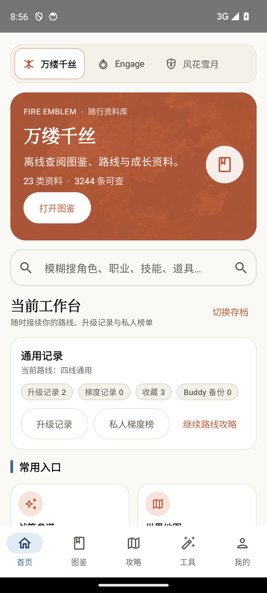
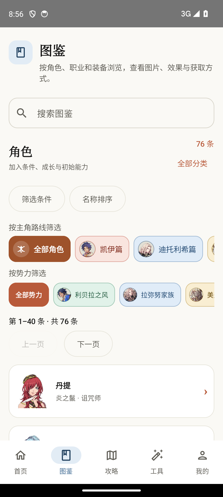
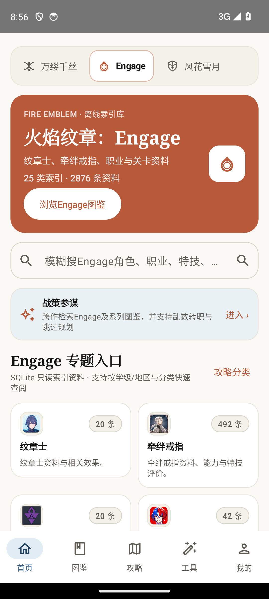
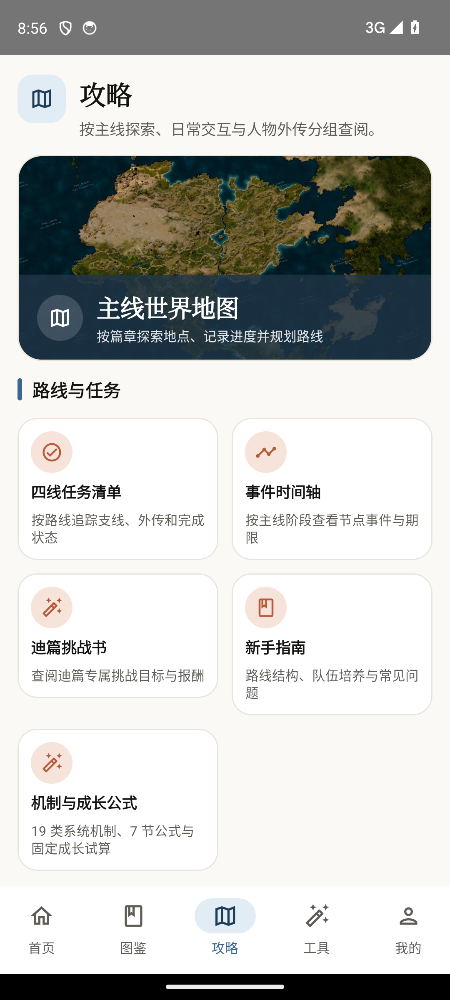
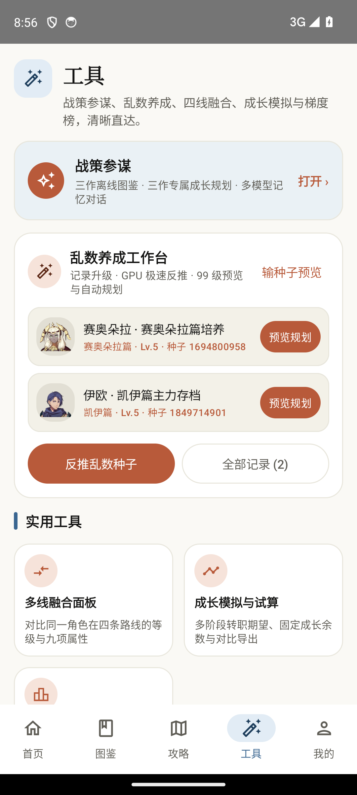
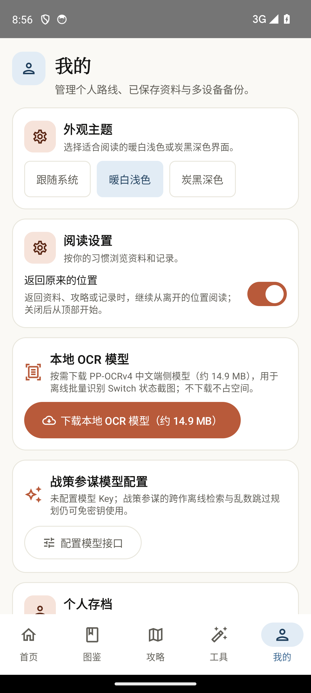
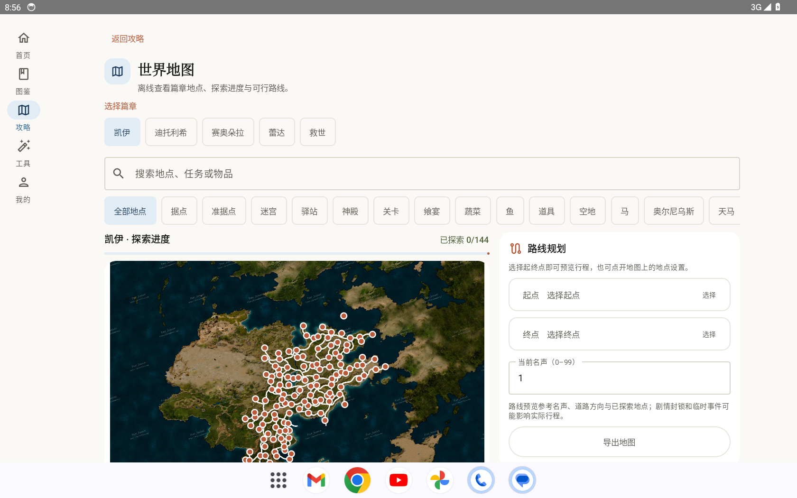
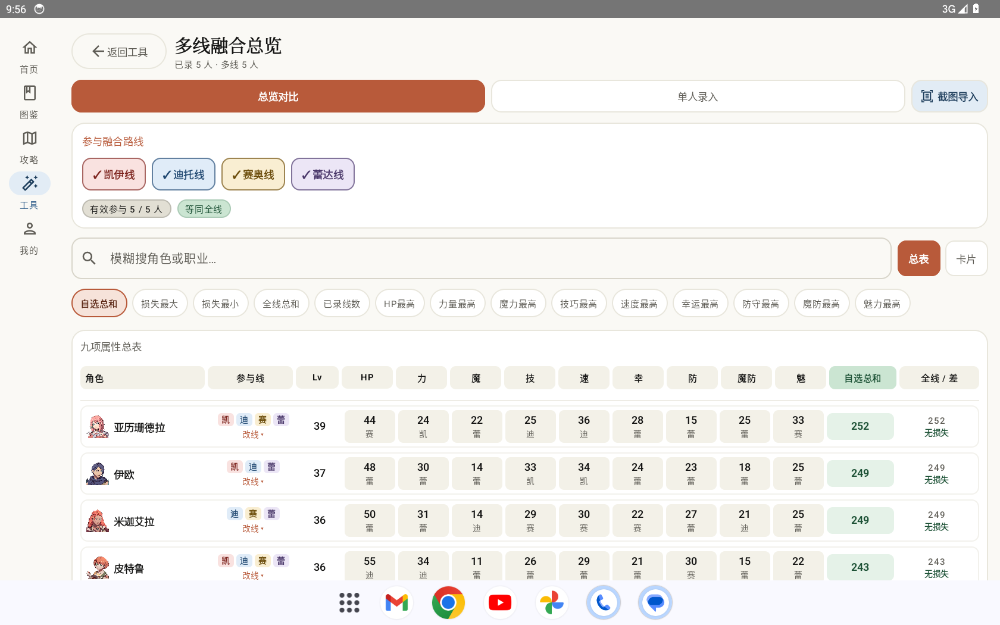
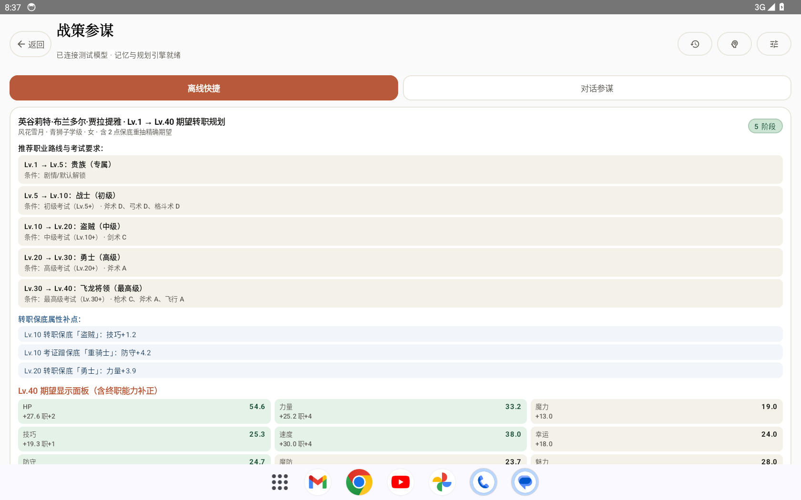

# 火纹个人助手 · Fire Emblem Companion

<p align="center">
  <b>一部装进口袋与平板的《火焰纹章》全离线随行战术终端</b><br />
  全面覆盖 <b>《万缕千丝》</b> · <b>《风花雪月》</b> · <b>《Engage（结合）》</b> 三部作品
</p>

<p align="center">
  
  
  
  
  
</p>

玩火纹时，你是否经常在手机浏览器、Excel 表格、攻略网站和截图相册之间来回切屏？

**火纹个人助手** 将三部作品的离线图鉴、高清互动世界地图、**Switch 截图批量 OCR 识图对比多线培养**、**GPU 极速乱数反推** 以及 **AI「战策参谋」规划并一键导入角色个人成长路线** 全部整合进一款原生 Android 应用——**断网秒开、手机竖屏顺手、平板横屏双栏高效**，让每一场战局与每一次转职都有据可依。

---

## 为什么选择它？（五大核心体验）

- **📸 Switch 截图本地 OCR 批量识别 → 秒级对比四线多线培养**
  打完《万缕千丝》多条路线，不再需要对着电视逐项手抄九维属性！内置按需下载的 **PP-OCRv4 中文端侧模型（仅 14.9 MB，100% 本地离线推理）**，一次多选多张 NS 角色状态截图，自动识别角色、等级、职业、路线与九项属性，核对入库后立刻在**四线多路线融合面板**中横向比对，绿色星标一眼锁定每项最高值、融合总上限以及取消某条路线时的属性损益。
- **🤖 「战策参谋」AI 规划 → 一键直接导入角色个人成长规划**
  不仅能聊天查三作图鉴，更能直接调用本地精确算法求解三作专属养成方案！在《万缕千丝》中，AI（或零密钥离线快捷模式）为你算好带**前期转职门控**、`需考试解锁` 门槛提示与**加权跳点（考试跳乱数）**的「转职分档方案」后，点击 **「一键导入成长工作台」**，方案内的每一次转职节点、跳过时机、权重与职业路径会**直接写入该角色的个人成长规划与 99 级养成工作台**，马上就能微调方案、落盘保存并跟着进度一步步升级打卡。
- **⚡ 手机 GPU 计算着色器极速反推乱数种子**
  基于零 NDK 的 **OpenGL ES 3.1 Compute Shader + 64-bit Barrett 魔数算法**，录入 4 次升级即可在手机/平板 GPU 上高速遍历全量 `uint32` 种子空间并由 CPU 逐位精确核验（不兼容设备自动无缝回退多核 CPU），立刻解锁后续至 **Lv.99** 的全部升级跳点、同种子换职对比与考试概率门槛。
- **📚 三作 7,927 条全离线图鉴 + 61,438 路网节点互动地图**
  内置《万缕千丝》《风花雪月》《Engage》三作预制 SQLite 资料库与 **2,512 张本地 WebP 立绘/图标**；全站支持模糊联想搜索与头像视觉筛选；更有《万缕千丝》5 篇章 **1,242 点位** 高清互动地形图、163 种素材反查与 **Dijkstra 最短路径规划**。
- **🔐 多周目存档隔离 & 端到端加密跨设备同步**
  手机随手记录、平板大屏规划：支持多周目存档隔离、DAG 修订历史与冲突可视化合并、本地加密备份，以及 **端到端加密 WebDAV 云同步**；API Key 与同步凭据全部经 `AndroidKeyStore` 硬件级 **AES-256-GCM** 加密存储。

---

## 实机与模拟器界面预览

> 以下全部截图采集自 Android 手机（竖屏 `NavigationBar`）与平板（横屏 `NavigationRail` + 双栏工作台）实际运行画面。

### 手机竖屏体验

<table>
  <tr>
    <td align="center" width="33%">
      <br />
      <b>首页总览</b><br />
      <sub>三作一键切换、全局模糊搜索、个人工作台状态与快捷入口</sub>
    </td>
    <td align="center" width="33%">
      <br />
      <b>《万缕千丝》角色图鉴</b><br />
      <sub>主角路线与势力阵营头像视觉筛选、立绘与分页检索</sub>
    </td>
    <td align="center" width="33%">
      <br />
      <b>三作切换 ·《Engage》</b><br />
      <sub>25 类 2,876 条离线索引：纹章士、牵绊戒指与全角色职业</sub>
    </td>
  </tr>
  <tr>
    <td align="center" width="33%">
      <br />
      <b>攻略百科中心</b><br />
      <sub>主线世界地图、四线任务清单、事件时间轴、机制公式与日常社交</sub>
    </td>
    <td align="center" width="33%">
      <br />
      <b>工具中心</b><br />
      <sub>战策参谋、乱数养成工作台（已定位种子一键直达）与实用工具</sub>
    </td>
    <td align="center" width="33%">
      <br />
      <b>我的 · 偏好与本地 OCR</b><br />
      <sub>浅色/深色主题、阅读位置记忆、14.9 MB 本地 OCR 模型与云同步</sub>
    </td>
  </tr>
</table>

### 平板宽屏与双栏工作台

<table>
  <tr>
    <td align="center" width="50%">
      <br />
      <b>《风花雪月》双栏图鉴详情</b><br />
      <sub>左侧导航栏 + 学级筛选 + 右侧默认/五年后立绘与分位评级面板</sub>
    </td>
    <td align="center" width="50%">
      <br />
      <b>《万缕千丝》交互式世界地图</b><br />
      <sub>5 篇章 1,242 点位、真实道路网绘制、名声条件路线规划与导出</sub>
    </td>
  </tr>
  <tr>
    <td align="center" width="50%">
      <br />
      <b>99 级乱数养成工作台（个人规划落地页）</b><br />
      <sub>承接战策参谋一键导入的转职与跳点计划，支持逐级换职对比与保存</sub>
    </td>
    <td align="center" width="50%">
      <br />
      <b>四线多路线融合总览 + OCR 截图导入</b><br />
      <sub>顶部一键「截图导入」批量识图，全角色四线属性峰值与损益一目了然</sub>
    </td>
  </tr>
  <tr>
    <td align="center" colspan="2">
      <br />
      <b>单人四线培养横向对比</b><br />
      <sub>自由勾选参与融合的路线，绿色星标高亮各项最高值与融合上限，直达角色图鉴</sub>
    </td>
  </tr>
</table>

### 战策参谋 · 三作专属成长规划

<table>
  <tr>
    <td align="center" width="50%">
      <br />
      <b>《万缕千丝》转职分档方案</b><br />
      <sub>前期未解锁门控、路线限定过滤、<code>需考试解锁</code> 门槛与<b>一键导入个人工作台</b></sub>
    </td>
    <td align="center" width="50%">
      <br />
      <b>《风花雪月》期望转职规划</b><br />
      <sub>2 点保底重抽精确期望、自动 5 阶段路线与 <code>Lv.10 重骑士</code> 考证蹭保底</sub>
    </td>
  </tr>
  <tr>
    <td align="center" width="50%">
      <br />
      <b>《Engage》固定成长精确推算</b><br />
      <sub>100% 确定性满 100 进 1 累加器、大师证转职差值、9 维含体格与余数面板</sub>
    </td>
    <td align="center" width="50%">
      <br />
      <b>可展开逐级明细预览</b><br />
      <sub>三作规划卡片均支持展开提前预览每一级跳点（+1/+2）或当前面板(余数)</sub>
    </td>
  </tr>
</table>

---

## 核心功能全景

### 1. Switch 截图本地 OCR 批量识别 × 四线多线培养对比

针对《万缕千丝》四条主角路线（凯伊 / 迪托利希 / 赛奥朵拉 / 蕾达）并行的多线养成痛点，应用打通了 **「截屏批量识图 → 人工快审 → 多线横评决策」** 完整闭环：

1. **端侧离线 PP-OCRv4 识别引擎（`LocalOnnxOcrRecognizer` + `OcrModelManager`）**：
   - 在「我的 → 本地 OCR 模型」按需下载约 **14.9 MB** 的中文端侧检测/识别模型（带 SHA-256 校验，可随时一键删除释放空间）；推理全程在本地 ONNX Runtime 执行，无需联网、不上传图片。
   - 同时支持在「战策参谋」模型配置中可选启用**多模态视觉模型**作为 OCR 备选通道。
2. **多图一键批量导入与结构化解析（`RouteMergeOcrImportSheet` + `NsScreenshotStatParser`）**：
   - 在「多线融合面板」点击右上角 **「截图导入」**，可一次从相册勾选多张 Switch 角色状态截图。
   - 自动匹配内置图鉴角色/职业词典，提取**角色名、所属路线、等级、当前职业与九项基础属性**，对低置信度字段自动标色提示，支持在审核卡片中快速微调并一键批量落盘。
3. **四线融合总览与单人横评（`RouteMergeScreen`）**：
   - **总览矩阵模式**：一屏对比全队角色在四条路线的最高等级、各项峰值属性来源与融合总和，支持按自选总和、单项最高、融合损失大小排序。
   - **单人横评模式**：自由勾选/取消任意路线（不删原始数据），实时对比「自选路线融合」与「四线全开参考」的每项差值，帮你决定哪条线的哪位角色最值得保留投入。

### 2. 「战策参谋」AI 助手与个人成长规划无缝闭环

「战策参谋」提供 **「离线快捷」** 与 **「对话参谋」** 双模式——**不填任何 API Key 也能完整使用三作离线规划器与跨作图鉴检索**。

#### Agent 规划直通「角色个人成长规划」
- 无论是在「对话参谋」中让 AI 读取你存档里的种子和属性自动规划，还是在「离线快捷」中手动微调参数，生成《万缕千丝》**转职分档方案**卡片后：
  - 先可在卡片内横向切换不同转职次数档位（不转职基准 / 转 1 次 / 转 2 次 / 全局最优），并**展开逐级加点与跳过明细**提前预览每一级的收益；
  - 选中心仪方案后，点击 **「一键导入成长工作台」**，确认即可将该方案的种子起点、自定义九维权重、每一次**转职节点**与**考试跳过步骤**直接写入你的个人存储（`SeedWorkbenchRecord`），并立即打开 **99 级养成工作台（培养计划页）**；
  - 进入工作台后可继续逐级替换职业、插入临时考试/跳过、保存为角色个人培养方案，并在日常游玩时按步骤打卡推进；返回时自动还原战策参谋原对话滚动位置。

#### 三作专属成长与转职规划引擎
- **《万缕千丝》转职分档方案（`ParetoGrowthPlanner`）**：
  - 结合精确乱数种子搜索多档最优路径，支持自定义九维权重、按总跳点或加权分设定**考试跳过不想要的加点**。
  - **前期可行性门控**：角色仅解锁 0 阶基础职业且低等级时，默认限制未解锁职业从 **Lv.10 起** 预演转职，杜绝在资格考试尚未开放时给出不可行建议；用户可随时自定义「最早转职等级」。
  - 自动按当前篇路线过滤不可获取的路线限定/第三部专属职业，并为所有未解锁节点清晰标注 **`需考试解锁`** 及推荐等级、名声、武器等级与票证要求。
- **《风花雪月》期望成长与转职规划（`ThreeHousesGrowthPlanner`）**：
  - 覆盖 40 名角色与过滤 NPC/敌方/魔兽后的全部可用职业，严格校验性别、专属与初级/中级/高级/最高级考试条件。
  - 对学生与主角采用 **9 维 2 点保底重抽的精确泊松-二项分布（Poisson-Binomial）闭式期望**，并完整计算**转职保底永久补点**与**考证蹭保底**（如 `Lv.10 重骑士` 补防守至 12 后仍转高成长职业升级），卡片支持展开逐级期望面板。
- **《Engage》固定成长精确推算器（`EngageFixedGrowthPlanner`）**：
  - 100% 确定性复现超难/固定模式满 100 进 1 累加器（初始余数 = 个人成长率 `% 100`、大师证/横转基础值切换且余数跨职保留、有效上限钳制）。
  - 支持 9 维含「体格」、**贾恩「努力家」** 职业成长 `×2`、**琪姬「星玉的加护」** 全成长 `+15%`，逐级明细支持在「每级跳点（`+1/+2`）」与「当前面板（余数）」视图间自由切换。

#### Pi 风格多模型架构与记忆系统
- **多模型注册表与角色分工**：支持 DeepSeek、阿里百炼（千问）、Anthropic Claude、硅基流动以及任意 OpenAI 兼容 HTTPS / 局域网本地网关；可独立指定 **主对话模型** 与 **记忆整理/上下文压缩模型**。
- **自动记忆与上下文压缩**：多历史会话持久化与新建/分支切换；对话推进时自动提炼用户养成偏好进入长期记忆库，达到上下文阈值自动摘要压缩，避免长对话超限或失忆。
- **富文本 Markdown & 跨作图鉴引用**：原生渲染标题、表格与代码块；AI 回复附带可点击的三作图鉴引用徽标，直达对应词条并返回原位置。

### 3. 乱数养成工作台与 GPU 计算着色器反推

- **升级记录册**：记录角色每次升级的九维跳点、资格考试（概率与成败）、换职与跳过，支持导入外部 `FE_Rigging_Buddy` 备份与成长种子 JSON。
- **GPU 极速反推**：无需 NDK，通过 **OpenGL ES 3.1 Compute Shader + 64-bit Barrett 魔数乘法 + 工作组共享内存规约** 在移动端 GPU 极速遍历 `2^32` 种子空间，首次自动执行确定性自检、结果由 CPU 逐位精确核验，不兼容驱动自动无缝回退多核 CPU。
- **99 级养成工作台**：实时预览后续至 Lv.99 的每一次升级与考试最低概率门槛、查看同种子**换职对比**、执行自动转职规划并持久化保存个人方案。
- **实用辅助工具**：另内置多阶段**成长模拟与试算**（期望 / 固定成长余数对比导出）与三作**私人梯度榜**（自由分档排序与写评语）。

### 4. 三作全离线图鉴、攻略百科与交互式世界地图

- **三作 7,927 条全离线资料**：顶部一键切换《万缕千丝》《Engage》《风花雪月》，全站模糊联想检索（支持子序列与容错拼写）、角色视觉头像筛选、最近浏览与返回原阅读位置。
- **《万缕千丝》高清互动世界地图**：5 篇章 **1,242 点位**（18 种类型）、**163 种素材**反查、**61,438 路网节点**与 **60,753 条边**，支持手势缩放、按存档隔离探索打卡、结合名声与已发现地点的 **Dijkstra 最短路径规划** 以及高清路线图导出。
- **完整流程与社交攻略**：四线任务清单、74 条事件时间轴、迪篇挑战书、新手指南、19 类 463 条系统机制与成长公式、礼物偏好双向反查、三人用餐搭配、2,016 对支援关系、485 条逗鸟问答、种植收获与肥料地图直达、复兴清单库存缺口追踪、剧场演出，以及带主动防剧透确认开关的 206 条结局后日谈。

### 5. 多周目个人存档与端到端加密同步

- **多存档隔离**：不同周目/路线的升级记录、个人成长规划、世界地图探索、四线融合、收藏与梯度榜完全隔离。
- **DAG 修订历史与冲突解决**：跨设备同步遇并发修改时可视化提示冲突并由你选择保留版本，绝不静默丢数据。
- **端到端加密备份 & WebDAV 云同步**：支持口令加密本地备份导出/导入及 WebDAV 跨设备同步，所有密钥与凭据经 `AndroidKeyStore` 硬件级 AES-256-GCM 加密。

---

## 离线数据包实测规模

| 离线资料包 | 内置数据库 | 分类数 | 词条与核心内容 | 本地 WebP 图片 |
| :--- | :--- | :---: | :--- | :---: |
| **《万缕千丝》图鉴与攻略** | `wiki/content.db` | 23 | **3,244 词条** / 6,021 关联（76 角色、63 职业、577 特技、435 战技、478 武器、2,016 支援对、463 机制、485 逗鸟、206 结局） | 915 张 |
| **《风花雪月》资料包** | `games/three-houses/pack.db` | 14 | **1,807 词条** / 2,008 关联（40 角色全中文面板与成长、92 职业、367 技能战技、353 装备、84 章节、304 支援） | 564 张 |
| **《Engage》资料包** | `games/engage/pack.db` | 25 | **2,876 词条**（42 主角团、68 职业含 59 完整上下限、20 纹章士、492 牵绊戒指、531 特技、405 武器、765 成就） | 1,033 张 |
| **《万缕千丝》世界地图** | `world-map/maps.db` | 5 篇章 | **1,242 点位**（18 类型）、**163 素材**（2,839 采集点）、**61,438 路网节点**、60,753 道路边 | 高清地形图 |

---

## 技术架构与目录

采用 **`:core-domain`（纯 Kotlin 领域与算法引擎）+ `:android-app`（Jetpack Compose Material 3 客户端）** 双模块设计：

```text
fireemblem/
├── core-domain/          # 纯 JVM Kotlin：乱数/期望/固定成长规划引擎、模糊匹配、OCR 解析器、
│                         # 世界地图 Dijkstra 路网、Agent 协议、DAG 加密同步与完整单测
├── android-app/          # Android Jetpack Compose 客户端：双端自适应 UI、OpenGL ES 3.1 GPU 反推、
│                         # ONNX Runtime PP-OCRv4、SQLite 离线资料库、多模型 AI 与 WebDAV 同步
├── tools/                # Python 离线资料构建管线（SQLite / WebP / 规则基线生成与校验）
├── .github/workflows/    # GitHub Actions 自动测试、构建与 Release 发布工作流
└── docs/screenshots/     # 手机与平板端实机展示截图
```

---

## 构建、自动化发布与开发

### 本地构建

- **环境要求**：JDK 21 · Android SDK（`compileSdk 37` / `targetSdk 36`）· Python 3 + Pillow
- **常用命令**：

```bash
# 运行领域层单元测试、Lint 静态检查与 Debug APK 构建
./gradlew :core-domain:test :android-app:lintDebug :android-app:assembleDebug

# 覆盖安装到已连接的 Android 手机/平板（保留个人数据）
adb install -r -d android-app/build/outputs/apk/debug/android-app-debug.apk
```

### GitHub Actions 自动构建发布

- 每次向主分支推送代码或打版本标签时，GitHub Actions 自动执行 `:core-domain:test` 单元测试、`:android-app:lintDebug` 检查、构建 APK 并自动发布至 **GitHub Releases**（支持配置正式签名 Keystore Secrets 输出正式签名 Release APK；未配置时自动输出可直接安装的构建版本与 SHA-256 校验文件）。

---

## 功能规划（Roadmap）

### 已完成里程碑
- [x] **v0.1**：《万缕千丝》全量离线图鉴、交互式世界地图与 Dijkstra 路径规划、全套日常攻略、多存档与端到端加密 WebDAV 同步。
- [x] **v0.15**：OpenGL ES 3.1 GPU 极速种子反推、99 级养成工作台、四线多路线融合面板、端侧 PP-OCRv4 Switch 截图批量识别、《风花雪月》与《Engage》离线资料包接入。
- [x] **v0.2**：战策参谋 Pi 风格多模型注册表与分轨记忆/压缩、全站模糊搜索与头像视觉筛选、阅读滚动位置还原、《万缕千丝》转职分档方案（前期门控 + `需考试解锁` + 一键导入角色个人规划）、《风花雪月》精确 2 点保底重抽与考证蹭保底规划、《Engage》固定成长推算器。

### 后续演进方向
- [ ] **《Engage》纹章士 & 继承技能配装联动**：结合内置 20 纹章士与 531 特技，规划 SP 预算、牵绊解锁顺序与武器刻印并接入战策参谋。
- [ ] **《风花雪月》熟练度与周常教学排程**：联动每阶段职业武器/飞行门槛，估算指导周数与才能绽放节点。
- [ ] **跨作 OCR 批量识图扩展**：将 Switch 端侧 OCR 批量识别扩展至《风花雪月》与《Engage》角色状态截图，一键导入对应规划器。
- [ ] **WebDAV 增量同步与局域网快传**：提升多设备日常同步速度，新增同步状态提醒与一键定时备份。
- [ ] **平板大屏深度增强**：支持外接键盘快捷键检索与双角色成长路线并排对比视图。

---

## 资料来源与第三方组件

本项目离线资料、算法规则与端侧能力整理或引用自以下网站、开源项目与公开模型（详见 [`THIRD_PARTY_NOTICES.md`](THIRD_PARTY_NOTICES.md)）：

### 游戏资料与算法参考来源

| 作品 / 模块 | 来源名称 | 网址 / 仓库 | 用途说明 |
| :--- | :--- | :--- | :--- |
| **《万缕千丝》图鉴与攻略** | 《火焰之纹章 万紫千红》社区在线数据表 | https://docs.qq.com/sheet/DV0N0VUZLSXRmUWFq?tab=lnafol | 角色、职业、血印、特技、战技、魔法、武器、饰品、道具、外传、支线、坐骑、军团、礼物、料理、时间轴、挑战书等图鉴数据 |
| **《万缕千丝》地图与专题** | fireemblem.top | https://fireemblem.top/ | 世界地图地形与路网点位（`/api/world-map`）、结局后日谈（`/topics/endings`）、种植（`/database/planting`）、支援（`/archive/supports`）、系统机制与成长公式（`/archive/mechanics`、`/topics/growth-mechanics`）、成长模拟参考（`/tools/growth-simulator`） |
| **《万缕千丝》逗鸟问答** | KeenGamer / RaiderKing（经社区在线表校对） | https://www.keengamer.com/ · https://raiderking.com/ | Perfect Bird Time 全角色逗鸟问答参考 |
| **《万缕千丝》乱数算法参考** | FE_Rigging_Buddy | https://github.com/kskdmcph58-lgtm/FE_Rigging_Buddy | 乱数种子反推、成长预测规则基线（参考提交 `016f048b5c636035ac0b56b0c4b9d89a742fba4a`）与角色头像索引；当前规则基线按「凯伊篇」与「其它路线」区分 |
| **《风花雪月》基础图鉴** | Fire Emblem Wiki (fireemblemwiki.org) | https://fireemblemwiki.org/ | 角色、职业、初始属性与成长率、技能、战技、魔法、武器、道具、纹章、骑士团、章节、支援、礼物、餐厅与茶会数据 |
| **《风花雪月》部分素材** | Fire Emblem Wiki (Fandom) | https://fireemblem.fandom.com/ | 部分角色立绘与图标素材 |
| **《风花雪月》数值交叉核对** | Serenes Forest | https://serenesforest.net/three-houses/ | 职业成长率与骑士团数值交叉参考 |
| **《风花雪月》中文支援文本** | Fedatamine | https://houses.fedatamine.com/zh-cn/supports/ | 简体中文支援对话数据 |
| **《风花雪月》中文译名对照** | 萌娘百科 (Moegirlpedia) | https://zh.moegirl.org.cn/火焰之纹章_风花雪月 | 部分角色与词条简体中文译名对照 |
| **《Engage》核心资料** | 《火焰之纹章 ENGAGE结合》社区在线数据表 | 社区整理 Excel 表格 | 角色、职业基础值/成长率/上限、纹章士、牵绊戒指、特技、武器装备、索拉涅尔活动与成就资料 |
| **《Engage》章节与图标** | Fire Emblem Wiki (fireemblemwiki.org) | https://fireemblemwiki.org/wiki/List_of_chapters_in_Fire_Emblem_Engage | 章节索引与部分图标资源 |

### 端侧模型与开源依赖

- **端侧中文 OCR 模型**：**RapidOCR / PaddleOCR PP-OCRv4（Mobile ONNX）**，由用户按需从公开仓库下载，不随 APK 预装：
  - ModelScope：https://www.modelscope.cn/models/RapidAI/RapidOCR
  - Hugging Face：https://huggingface.co/RapidAI/RapidOCR （镜像：https://hf-mirror.com/RapidAI/RapidOCR ）
- **核心开源库**：Jetpack Compose & Material 3 · [ONNX Runtime Android](https://github.com/microsoft/onnxruntime) · [OkHttp](https://github.com/square/okhttp) · [Anthropic Java SDK](https://github.com/anthropics/anthropic-sdk-java) · Kotlinx Serialization & Coroutines。

---

## 免责声明

请在使用、构建或参考本项目前仔细阅读以下声明：

1. **非官方个人伴侣工具**：本项目为个人学习、研究与游玩辅助用途开发的非商业、非官方工具，与 **Nintendo（任天堂）**、**Intelligent Systems** 或任何游戏发行方、资料站点无任何隶属、合作或官方背书关系。
2. **知识产权与侵权联系**：《火焰纹章（Fire Emblem）》系列名称、角色设定、数值、图标、立绘、世界地图、游戏文本及各社区攻略站整理内容的相关权益均归其原版权方与原始作者/社区贡献者所有。本仓库不包含游戏本体程序、ROM 或破解内容，且严禁用于任何商业用途。**如任何版权方、网站或作者认为本项目引用的资料、链接或预制资源包侵犯了您的合法权益，请通过 GitHub Issue 联系，我们将在核实后第一时间删除相关内容。**
3. **数值与规划仅供参考**：应用内的图鉴数据、机制公式、乱数预测、期望成长及固定成长推算均基于社区公开资料与特定版本实测整理，不保证在游戏后续官方补丁更新后始终 100% 一致；因版本变动、录入误差、OCR 误识别或 AI 回复偏差导致的养成结果差异，请以游戏内实际显示为准，建议导入重要规划前核对确认并做好存档备份。
4. **AI 接口与隐私责任（BYOK）**：应用本身不提供、不代理、不内置任何商业大模型服务或免费额度。对话参谋所需的 API Key 与接口地址均由用户自行配置并仅使用 `AndroidKeyStore` 加密存储于本机，由此产生的第三方 API 调用费用、速率限制、内容合规性与服务商隐私条款均由用户自行承担并遵守对应服务商协议。
5. **无担保声明（AS-IS）**：本项目按「现状（AS-IS）」提供，不附带任何明示或暗示的适销性、特定用途适用性或不侵权担保。因使用本软件（包括但不限于本地存储、加密备份口令遗忘、第三方 WebDAV 服务异常等）造成的任何直接或间接数据损失，开发者不承担赔偿责任；请妥善保管加密备份口令并定期备份个人数据。
