# 火纹个人助手 · Fire Emblem Companion

<p align="center">
  <b>面向 Android 手机与平板的《火焰纹章》离线伴侣应用</b><br />
  支持 <b>《万缕千丝》</b> · <b>《风花雪月》</b> · <b>《Engage（结合）》</b> 三部作品的资料查阅与养成辅助
</p>

<p align="center">
  
  
  
  
  
</p>

**火纹个人助手** 是一款面向个人游玩的原生 Android（Jetpack Compose）伴侣应用，自适应**手机竖屏底部导航栏**与**平板横屏侧边导航栏 + 双栏工作台**。应用内置三作离线 SQLite 资料库，重点围绕《万缕千丝》的多线养成、乱数反推与转职规划构建闭环，同时提供《风花雪月》期望转职规划与《Engage》固定成长推算器。

---

## 核心功能概览

| 模块 | 当前已实现能力 | 状态说明 |
| :--- | :--- | :--- |
| **多线融合 × Switch 截屏 OCR** | 按需下载 14.9 MB 本地 PP-OCRv4 模型，离线批量识别 NS 状态截图（自动识别角色、篇章纹章、等级、职业、九维属性并做总和校验），一键写入多线融合面板横向对比同一可挖角角色在四条路线的峰值与路线子集损益 | 已完成 |
| **战策参谋（AI + 离线三作规划）** | 支持多模型配置（主对话 / 记忆压缩分轨路由）、自动记忆与上下文压缩、Markdown 表格与图鉴引用；**不配 API Key 也可离线使用三作规划器**。规划出的《万缕千丝》转职分档方案可**一键直接导入角色个人培养计划**逐步打卡 | 已完成 |
| **乱数反推与 99 级养成工作台** | 录入 4 次升级即可通过 GPU Compute Shader / 多核 CPU 定位种子，预览至 Lv.99 的每次跳点与考试门槛、同种子换职对比、手动编排/导入个人培养计划并逐步打卡 | 已完成 |
| **三作离线图鉴与模糊搜索** | 内置《万缕千丝》《风花雪月》《Engage》合计 62 分类 7,967 条离线词条与 2,533 张 WebP 图片，全站模糊联想下拉搜索、头像视觉筛选与阅读位置记忆 | 已完成 |
| **攻略百科、成长模拟与私人梯度榜** | 四线任务清单、时间轴、用餐三人搭配、礼物/支援/逗鸟/种植/复兴/剧场/防剧透结局、多阶段成长模拟器、私人梯度榜 | 已完成 |
| **多存档与加密 WebDAV 同步** | 多周目存档隔离、DAG 修订历史与冲突提示、口令加密本地备份、端到端加密 WebDAV 同步 | 已完成 |
| **《万缕千丝》离线世界地图** | 已支持 5 篇章地形底图缩放浏览、点位分类筛选与文字搜索、探索进度打卡、基于当前路网的基础起终点路线估算与 PNG 导出 | **持续完善中**（剧情动态封锁与更细粒度的地图联动仍在迭代） |

---

## 全功能实机与模拟器界面一览

以下 **37 张截图** 全部截取自 Android 手机与平板模拟器真实运行状态（暖白浅色主题）。

### 一、多线培养对比 × Switch 截屏本地 OCR 批量识别

针对《万缕千丝》中可跨多条路线挖角培养的角色（如亚历珊德拉、皮特鲁、媞雅拉、伊欧、米迦艾拉等），支持直接导入 Switch 状态截图离线批量识别九维属性，免去手抄，在多线融合面板中直接对比四线峰值并决定保留哪几条线。

<table>
  <tr>
    <td align="center" width="50%">
      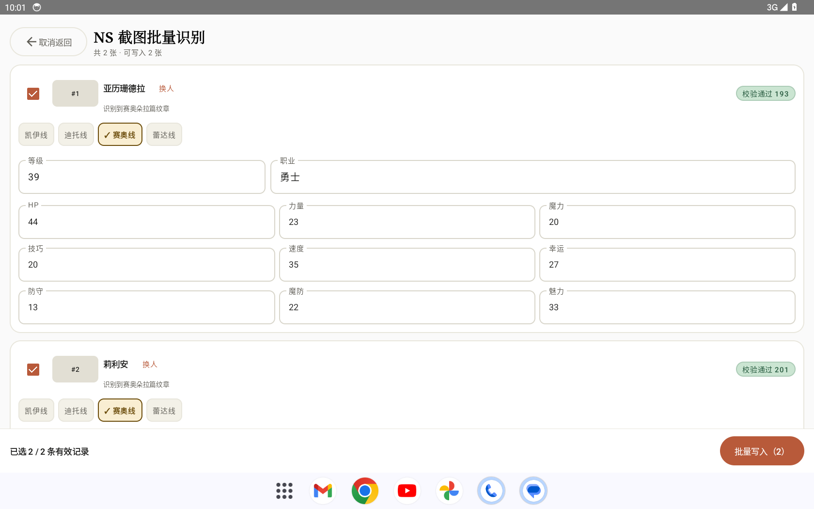<br />
      <b>Switch 截图本地 OCR 批量识别审核</b><br />
      <sub>本地 PP-OCRv4 离线识图，自动识别角色/篇章纹章/九维属性并做能力总和校验，确认后一键批量写入</sub>
    </td>
    <td align="center" width="50%">
      <br />
      <b>多线融合总览矩阵（真实四线可挖角角色）</b><br />
      <sub>一屏汇总亚历珊德拉、伊欧、米迦艾拉、皮特鲁等跨线角色在各线的峰值属性来源、自选总和与损益差值</sub>
    </td>
  </tr>
  <tr>
    <td align="center" colspan="2">
      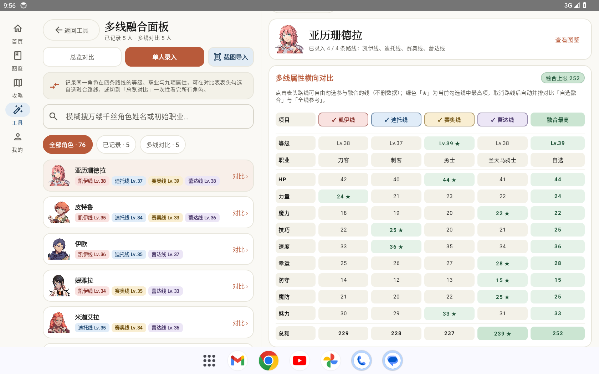<br />
      <b>单人四线横向对比（亚历珊德拉）</b><br />
      <sub>表头可自由勾选参与融合的路线（不删原始数据），绿色星标自动标注各项峰值与融合上限，右上角直达图鉴</sub>
    </td>
  </tr>
</table>

### 二、战策参谋（AI 对话 + 三作规划 → 一键导入角色个人培养计划）

支持「离线快捷」与「对话参谋」双模式。在对话或离线模式下算出的《万缕千丝》**转职分档方案**，可直接在卡片中切换档位、展开查看逐级收益，并点击 **「一键导入成长工作台」** 直接落盘为该角色的个人培养计划，在工作台中按步打卡推进。

<table>
  <tr>
    <td align="center" width="50%">
      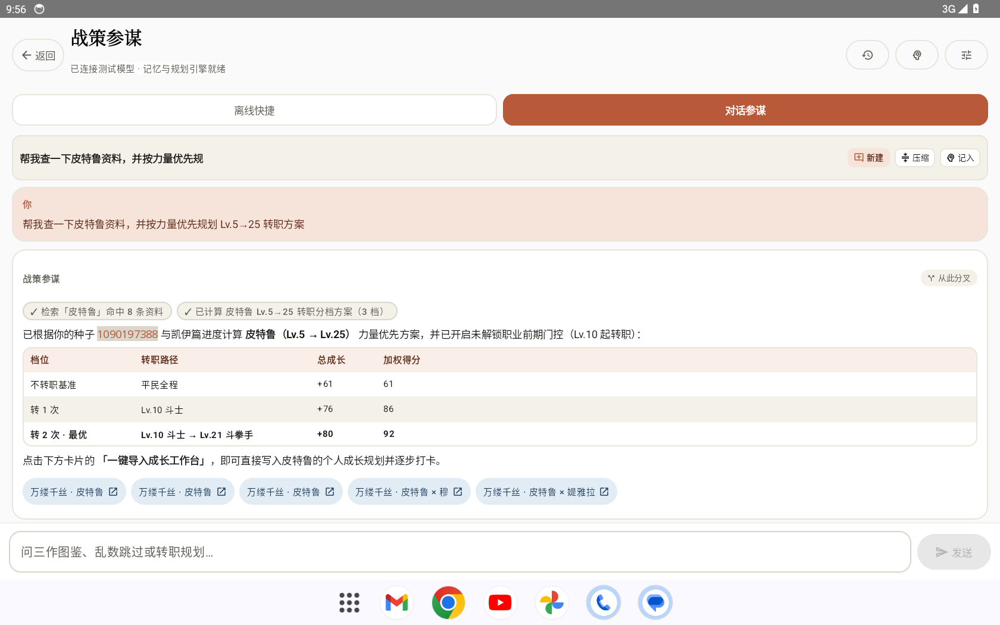<br />
      <b>战策参谋 · 对话模式</b><br />
      <sub>工具调用轨迹、Markdown 表格渲染、可点击图鉴引用徽标，以及新建会话 / 压缩上下文 / 记入记忆 / 分叉</sub>
    </td>
    <td align="center" width="50%">
      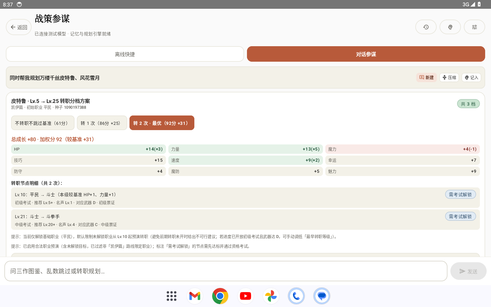<br />
      <b>《万缕千丝》转职分档方案</b><br />
      <sub>支持前期未解锁职业门控（默认 Lv.10 起）、路线限定过滤、<code>需考试解锁</code> 门槛明细与加权跳过</sub>
    </td>
  </tr>
  <tr>
    <td align="center" colspan="2">
      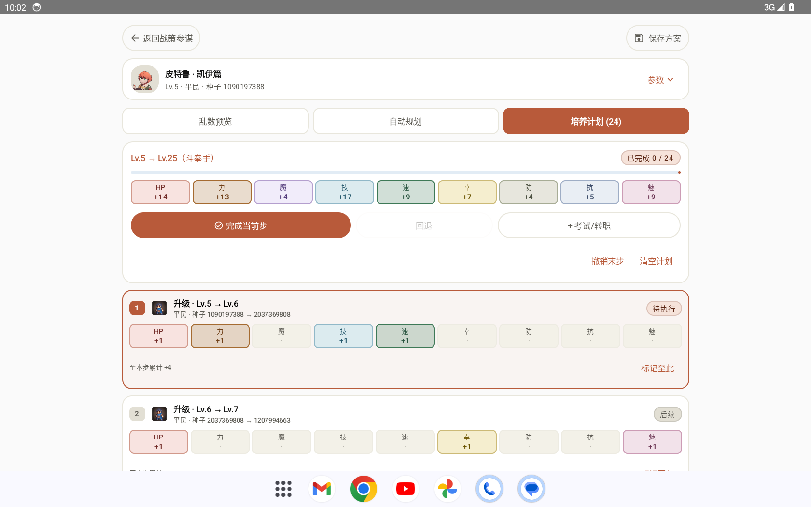<br />
      <b>一键导入直通「角色个人培养计划」</b><br />
      <sub>点选方案卡片导入后，自动生成皮特鲁 <code>Lv.5 → Lv.25</code> 完整 24 步个人计划，支持逐步打卡「完成当前步」、回退、临时插入考试/转职与保存方案</sub>
    </td>
  </tr>
  <tr>
    <td align="center" width="33%">
      <br />
      <b>《风花雪月》期望转职规划</b><br />
      <sub>9 维 2 点保底重抽精确期望 + <code>Lv.10 重骑士</code> 考证蹭保底</sub>
    </td>
    <td align="center" width="33%">
      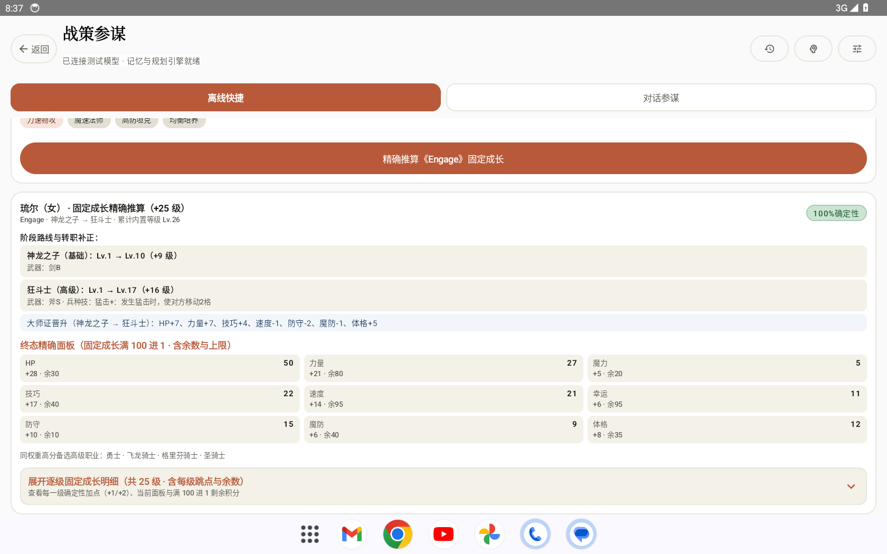<br />
      <b>《Engage》固定成长推算</b><br />
      <sub>满 100 进 1 确定性推算、大师证晋升差值、9 维含体格与余数</sub>
    </td>
    <td align="center" width="33%">
      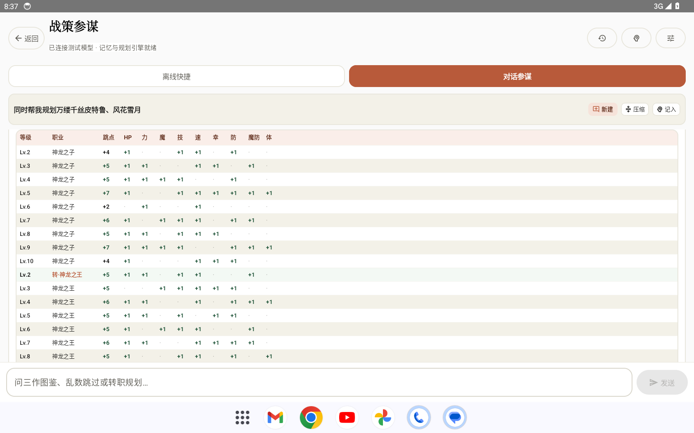<br />
      <b>可展开逐级跳点明细</b><br />
      <sub>提前预览每一级跳点（+1/+2）或当前面板与剩余积分</sub>
    </td>
  </tr>
</table>

### 三、乱数种子反推、99 级养成工作台、成长模拟与私人梯度榜

<table>
  <tr>
    <td align="center" width="33%">
      <br />
      <b>工具中心（手机竖屏）</b><br />
      <sub>战策参谋、已定位种子的快捷角色卡与常用实用工具</sub>
    </td>
    <td align="center" width="67%">
      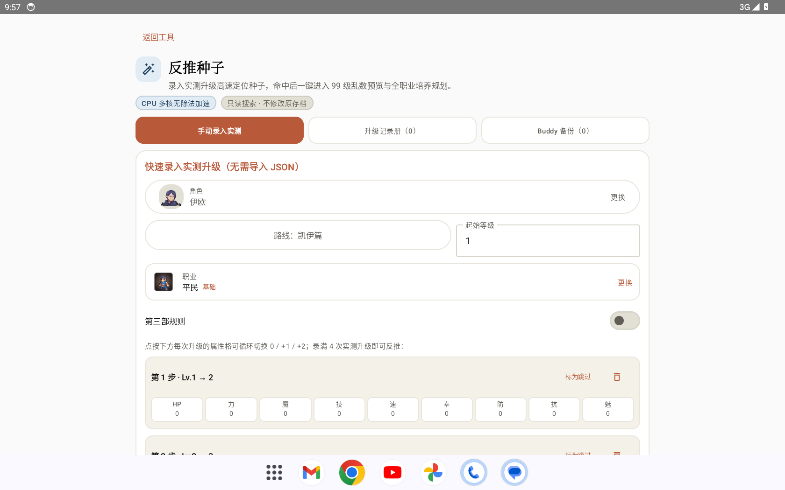<br />
      <b>乱数种子反推（手动录入 / 记录册 / Buddy 备份）</b><br />
      <sub>录满 4 次实测升级即可定位种子（支持移动端 GPU Compute Shader 与多核无除法 CPU 自动回退）</sub>
    </td>
  </tr>
  <tr>
    <td align="center" width="50%">
      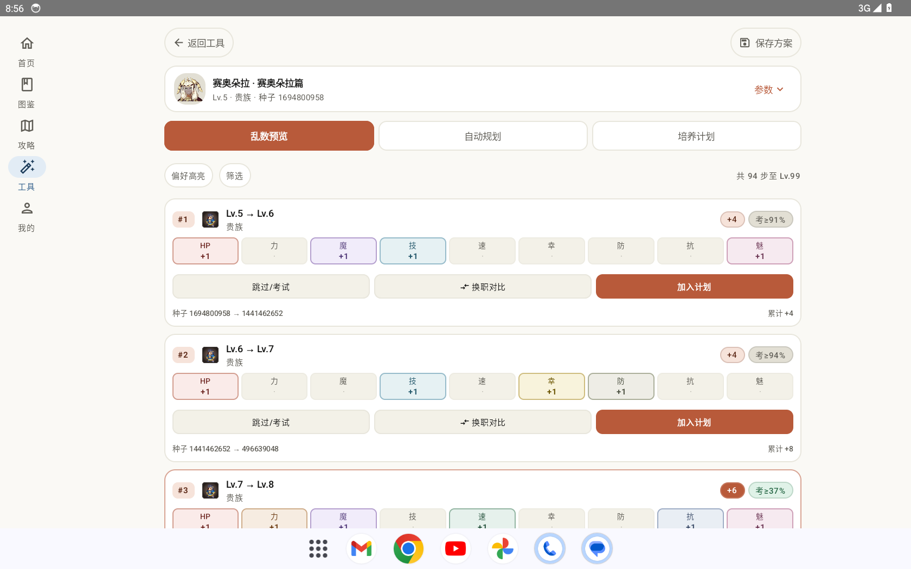<br />
      <b>99 级乱数预览与换职对比</b><br />
      <sub>展示后续至 Lv.99 每一级九维跳点、考试最低概率门槛、跳过/考试与同种子换职对比</sub>
    </td>
    <td align="center" width="50%">
      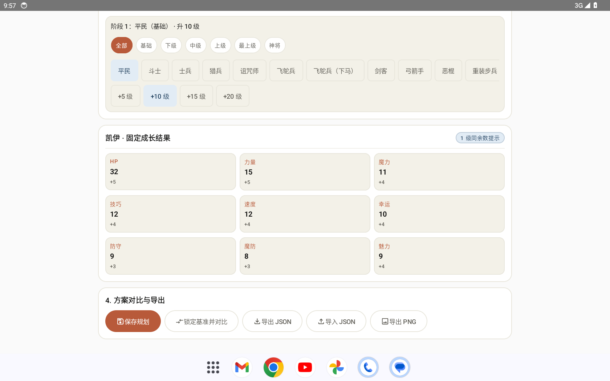<br />
      <b>成长模拟与试算</b><br />
      <sub>自由配置多阶段职业与升级数，查看随机期望 / 固定成长余数，支持基准锁定对比与 JSON/PNG 导出</sub>
    </td>
  </tr>
  <tr>
    <td align="center" colspan="2">
      <br />
      <b>私人梯度榜</b><br />
      <sub>支持新建多份个人梯度榜、自定义档位、调整角色顺位、写培养评语并导入/导出 JSON</sub>
    </td>
  </tr>
</table>

### 四、三作全离线图鉴与角色详情深度功能

三部作品的角色详情页均不只是静态文字列表，而是内置了**初始属性 / 成长率 / 上限修正分位评级、结构化可学技能矩阵（支持筛选角色专属 / 隐藏通用或纹章士传授 / 搜索）、支援对象与属性补正、礼物餐饮偏好、立绘多造型切换以及角色并排对比**等完整功能。

#### 4.1 首页入口、全站模糊搜索与《万缕千丝》角色详情全功能

<table>
  <tr>
    <td align="center" width="33%">
      <br />
      <b>首页总览</b><br />
      <sub>三作切换栏、工作台进度统计与图鉴直达</sub>
    </td>
    <td align="center" width="33%">
      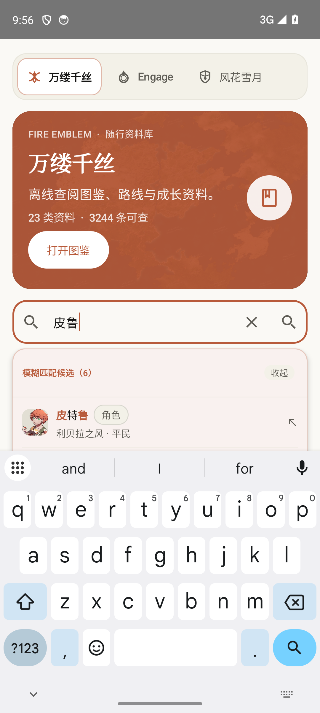<br />
      <b>全站模糊联想下拉</b><br />
      <sub>输入子序列（如 <code>皮鲁</code>）实时弹出带头像候选条目，点选直达详情</sub>
    </td>
    <td align="center" width="33%">
      <br />
      <b>《万缕千丝》视觉头像筛选</b><br />
      <sub>按主角路线与势力阵营头像卡片快速筛选 76 名角色</sub>
    </td>
  </tr>
  <tr>
    <td align="center" width="50%">
      <br />
      <b>《万缕千丝》角色详情 · 基础与成长率</b><br />
      <sub>全角色成长率四分位色卡、收藏、笔记、加入比较与四大专题页签</sub>
    </td>
    <td align="center" width="50%">
      <br />
      <b>《万缕千丝》角色 · 可学技能矩阵</b><br />
      <sub>按武器/熟练度分类展示 60 项可学特技与战技，支持「角色专属/隐藏通用技能」筛选与搜索</sub>
    </td>
  </tr>
  <tr>
    <td align="center" width="50%">
      <br />
      <b>《万缕千丝》角色 · 好感与支援</b><br />
      <sub>完整 63 位支援对象头像网格（标注组合加成与对话段数），下方同步收录喜好礼物与餐饮口味</sub>
    </td>
    <td align="center" width="50%">
      <br />
      <b>《万缕千丝》角色 · 逗鸟问答与结局</b><br />
      <sub>角色专属逗鸟台词与推荐反应速查，下方提供防剧透结局后日谈</sub>
    </td>
  </tr>
  <tr>
    <td align="center" colspan="2">
      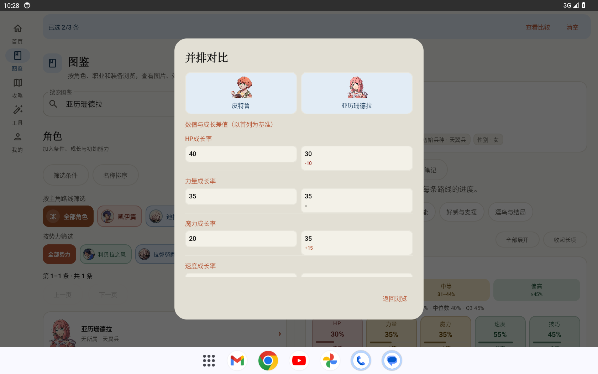<br />
      <b>《万缕千丝》角色并排对比</b><br />
      <sub>点击「加入比较」可任选多名角色并排对比成长率与初始属性，自动计算相对基准差值</sub>
    </td>
  </tr>
</table>

#### 4.2 《风花雪月》角色详情全功能（立绘切换 · 挖角门槛 · 技能矩阵 · 支援）

<table>
  <tr>
    <td align="center" width="50%">
      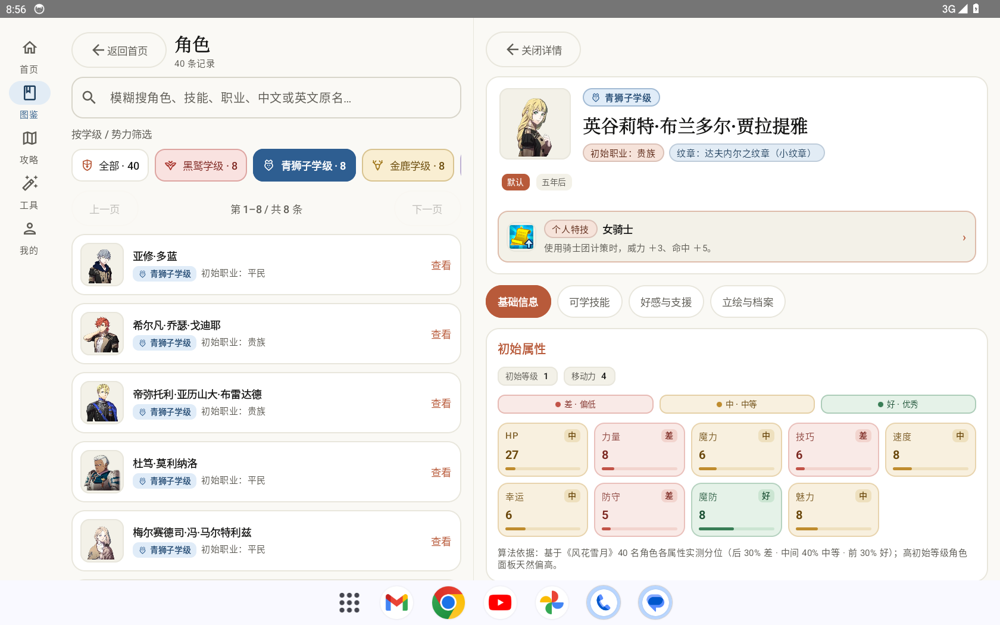<br />
      <b>《风花雪月》角色 · 初始属性与个人特技</b><br />
      <sub>学级筛选、纹章标签、默认/五年后立绘切换、个人特技与 40 角色分位评级</sub>
    </td>
    <td align="center" width="50%">
      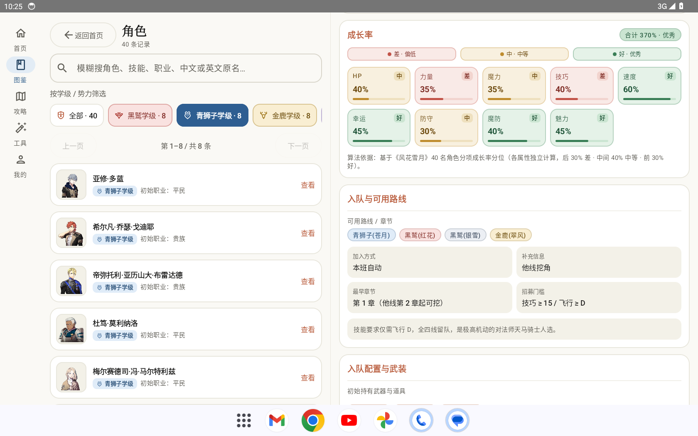<br />
      <b>《风花雪月》角色 · 成长率与四线挖角门槛</b><br />
      <sub>成长率分位与合计值（如 370%）、可用路线标签、挖角属性/技能门槛与入队武装</sub>
    </td>
  </tr>
  <tr>
    <td align="center" width="50%">
      <br />
      <b>《风花雪月》角色 · 可学技能矩阵（含五年后造型）</b><br />
      <sub>展示 75 项可学特技/战技/魔法、武器初始等级与「★ 擅长 / 才能绽放」，支持隐藏通用技能与搜索</sub>
    </td>
    <td align="center" width="50%">
      <br />
      <b>《风花雪月》角色 · 好感与支援</b><br />
      <sub>全部支援伙伴头像卡片（点开可查阅 C/B/A 简体中文支援对话），下方收录礼物与餐厅偏好</sub>
    </td>
  </tr>
</table>

#### 4.3 《Engage（结合）》角色与纹章士详情全功能

<table>
  <tr>
    <td align="center" width="33%">
      <br />
      <b>《Engage》资料首页</b><br />
      <sub>25 类 2,876 条离线资料，含 42 角色、20 纹章士与 492 牵绊戒指</sub>
    </td>
    <td align="center" width="67%">
      <br />
      <b>《Engage》角色 · 国家筛选、多造型与初始面板</b><br />
      <sub>按里特司/费列聂/布罗帝亚/索尔姆/伊尔席翁筛选，支持多造型切换、个人特技与含初始 SP / 体格的分位面板</sub>
    </td>
  </tr>
  <tr>
    <td align="center" width="50%">
      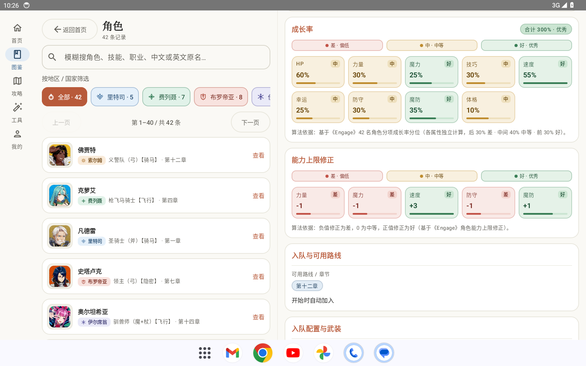<br />
      <b>《Engage》角色 · 成长率与能力上限修正</b><br />
      <sub>个人成长率分位（含体格）、角色专属能力上限正负修正色卡与入队章节/武装</sub>
    </td>
    <td align="center" width="50%">
      <br />
      <b>《Engage》角色 · 技能与天性资质</b><br />
      <sub>固有特技 + 兵种特技 + 武器天性擅长，支持「角色专属 / 隐藏纹章士传授」筛选与搜索</sub>
    </td>
  </tr>
  <tr>
    <td align="center" width="50%">
      <br />
      <b>《Engage》角色 · 支援属性补正与对象</b><br />
      <sub>顶部汇总 C/B/A/S 级支援命中/必避补正，列出全部支援对象与喜好礼物</sub>
    </td>
    <td align="center" width="50%">
      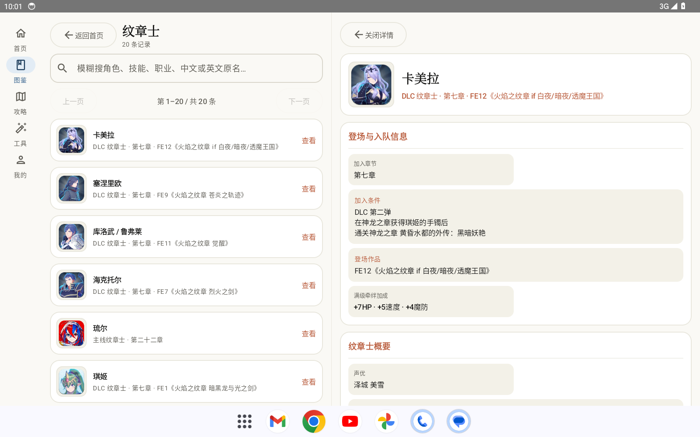<br />
      <b>《Engage》纹章士双栏详情</b><br />
      <sub>20 位纹章士完整登场章节、入队条件、满级牵绊属性加成与声优/技能档案</sub>
    </td>
  </tr>
</table>

### 五、攻略百科与世界地图（持续完善中）

<table>
  <tr>
    <td align="center" width="33%">
      <br />
      <b>攻略百科中心</b><br />
      <sub>四线任务清单、时间轴、挑战书、机制公式及全套日常社交攻略</sub>
    </td>
    <td align="center" width="67%">
      <br />
      <b>用餐三人搭配查询</b><br />
      <sub>按角色/菜品反查或自由组合三位角色，自动匹配共同偏好料理与关系等级</sub>
    </td>
  </tr>
  <tr>
    <td align="center" colspan="2">
      <br />
      <b>《万缕千丝》离线世界地图（功能持续完善中）</b><br />
      <sub>当前提供 5 篇章地形底图缩放、点位类型筛选与搜索、探索进度打卡及基础起终点路线参考与 PNG 导出；剧情动态封锁与更深入的地图联动仍在迭代中</sub>
    </td>
  </tr>
</table>

### 六、我的：偏好设置、端侧 OCR 模型管理、同步与资料来源

<table>
  <tr>
    <td align="center" width="50%">
      <br />
      <b>偏好设置、本地 OCR 与同步入口</b><br />
      <sub>浅色/深色主题、阅读位置记忆、14.9 MB 本地 PP-OCRv4 模型按需下载/删除、战策参谋配置、多存档与加密 WebDAV 同步</sub>
    </td>
    <td align="center" width="50%">
      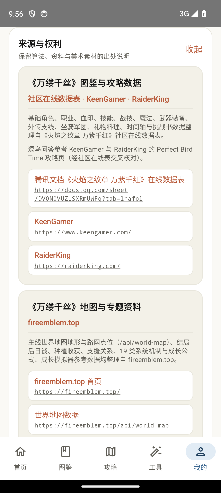<br />
      <b>App 内「来源与权利」</b><br />
      <sub>完整列出本项目所引用的所有资料网站、参考仓库、端侧模型与开源组件链接，点击可直接跳转查看</sub>
    </td>
  </tr>
</table>

---

## 离线数据包实测规模

| 离线资料包 | 内置数据库 | 分类数 | 词条与核心内容 | 本地 WebP 图片 |
| :--- | :--- | :---: | :--- | :---: |
| **《万缕千丝》图鉴与攻略** | `wiki/content.db` | 23 | **3,244 词条** / 6,021 关联（76 角色、63 职业、577 特技、435 战技、478 武器、2,016 支援对、463 机制、485 逗鸟、206 结局） | 915 张 |
| **《风花雪月》资料包** | `games/three-houses/pack.db` | 14 | **1,847 词条** / 2,047 关联（40 角色全中文面板、成长、课堂教导问答与烦恼信箱、全 40 角色茶会答案含 DLC 与蕾雅、92 职业、367 技能战技、353 装备、84 章节、304 支援） | 577 张 |
| **《Engage》资料包** | `games/engage/pack.db` | 25 | **2,876 词条**（42 主角团、68 职业含 59 完整上下限、20 纹章士、492 牵绊戒指、531 特技、405 武器、765 成就） | 1,041 张 |
| **《万缕千丝》世界地图** | `world-map/maps.db` | 5 篇章 | **1,242 点位**（18 类型）、**163 素材**（2,839 采集点）、**61,438 路网节点**、60,753 道路边 | 离线地形底图 |

---

## 技术架构与目录

采用 **`:core-domain`（纯 Kotlin 领域与算法引擎）+ `:android-app`（Jetpack Compose Material 3 客户端）** 双模块结构：

```text
fireemblem/
├── core-domain/          # 纯 JVM Kotlin：乱数/期望/固定成长规划引擎、模糊匹配、OCR 文本解析、
│                         # 地图路网算法、Agent 协议、DAG 加密同步与单元测试
├── android-app/          # Android Jetpack Compose 客户端：双端自适应 UI、OpenGL ES 3.1 GPU 反推、
│                         # ONNX Runtime PP-OCRv4、SQLite 离线资料库、多模型 AI 与 WebDAV 同步
├── tools/                # Python 离线资料构建管线（SQLite / WebP / 规则基线生成与校验）
├── .github/workflows/    # GitHub Actions 自动测试、构建与 Release 发布工作流
└── docs/screenshots/     # 手机与平板端实机/模拟器展示截图
```

---

## 本地构建与 GitHub Actions 自动发布

### 本地构建

- **环境要求**：JDK 21 · Android SDK（`compileSdk 37` / `targetSdk 36`）· Python 3 + Pillow（若从原始 `data/` 重建资料包）
- **使用预制离线资源包构建（无需本地 `data/`）**：
  1. 从 GitHub Releases 的 [`assets-v1`](https://github.com/renyumeng1/fireemblem-wiki-app/releases/tag/assets-v1) 下载 `offline-assets-pack.zip` 并解压到任意目录（如 `./prebuilt-assets`）；
  2. 执行：
     ```bash
     ./gradlew :core-domain:test :android-app:lintDebug :android-app:assembleDebug -PprebuiltAssetsDir=./prebuilt-assets
     ```

### GitHub Actions 自动构建发布与固定签名配置

仓库配置了 [`.github/workflows/release-apk.yml`](.github/workflows/release-apk.yml)，每次推送至 `main` 分支或推送 `v*` 标签都会自动运行单元测试、Lint、构建 APK 并发布至 GitHub Releases。

> **关于覆盖安装「签名冲突」的说明**：
> GitHub Actions 的 Linux 构建机每次运行都是全新临时环境，若未配置固定签名证书，Gradle 每次生成的临时 debug 证书指纹都不同，导致无法直接覆盖安装已有版本。
>
> 在仓库 **Settings → Secrets and variables → Actions** 中配置以下 **4 个 Repository Secrets** 即可开启固定签名自动发布（从此以后每次更新都能无缝覆盖安装、保留本机存档）：
>
> | Secret 名称 | 说明 |
> | :--- | :--- |
> | `ANDROID_KEYSTORE_BASE64` | Keystore 文件的 Base64 字符串 |
> | `ANDROID_KEYSTORE_PASSWORD` | Keystore 密码 |
> | `ANDROID_KEY_ALIAS` | 密钥别名（Alias） |
> | `ANDROID_KEY_PASSWORD` | 密钥密码 |

---

## 功能规划（Roadmap）

### 已完成里程碑
- [x] **v0.1**：《万缕千丝》离线图鉴、基础离线世界地图、四线任务清单与日常攻略、多存档与端到端加密 WebDAV 同步。
- [x] **v0.15**：GPU Compute Shader 乱数种子反推、99 级养成工作台、多线融合面板、端侧 PP-OCRv4 Switch 截图批量识别、接入《风花雪月》与《Engage》离线资料包。
- [x] **v0.2**：战策参谋多模型分轨路由与自动记忆/压缩、全站模糊搜索与视觉头像筛选、阅读滚动位置还原、《万缕千丝》转职分档方案（前期门控 + `需考试解锁` + 一键导入角色个人培养计划）、《风花雪月》精确 2 点保底重抽与考证蹭保底规划、《Engage》固定成长推算器。

### 后续演进计划
- [ ] **完善世界地图功能**：补全剧情阶段封锁条件、点位与图鉴/任务/种植采集的双向联动、更直观的路线步骤列表与标记管理。
- [ ] **《Engage》纹章士 & 继承技能配装联动**：结合内置 20 纹章士与 531 特技，规划 SP 预算、牵绊解锁顺序与武器刻印并接入战策参谋。
- [ ] **《风花雪月》熟练度与周常教学排程**：联动每阶段职业技能门槛（如斧 A / 飞行 A），辅助规划指导进度与才能绽放。
- [ ] **跨作 OCR 批量识图扩展**：将 Switch 端侧 OCR 批量识别扩展至《风花雪月》与《Engage》角色状态截图，直接导入对应规划器。
- [ ] **WebDAV 增量同步与大屏体验增强**：优化多设备日常同步速度，新增双角色养成路线并排对比视图。

---

## 资料来源与第三方组件

本项目离线资料、算法规则与端侧能力整理或引用自以下网站、开源项目与公开模型（详见 [`THIRD_PARTY_NOTICES.md`](THIRD_PARTY_NOTICES.md)）：

### 游戏资料与算法参考来源

| 作品 / 模块 | 来源名称 | 网址 / 仓库 | 用途说明 |
| :--- | :--- | :--- | :--- |
| **《万缕千丝》图鉴与攻略** | 《火焰之纹章 万紫千红》社区在线数据表 | https://docs.qq.com/sheet/DV0N0VUZLSXRmUWFq?tab=lnafol | 角色、职业、血印、特技、战技、魔法、武器、饰品、道具、外传、支线、坐骑、军团、礼物、料理、时间轴、挑战书等图鉴数据 |
| **《万缕千丝》地图与专题** | fireemblem.top | https://fireemblem.top/ | 世界地图地形与路网点位（`/api/world-map`）、结局后日谈（`/topics/endings`）、种植（`/database/planting`）、支援（`/archive/supports`）、系统机制与成长公式（`/archive/mechanics`、`/topics/growth-mechanics`）、成长模拟参考（`/tools/growth-simulator`） |
| **《万缕千丝》逗鸟问答** | KeenGamer / RaiderKing（经社区在线表校对） | https://www.keengamer.com/ · https://raiderking.com/ | Perfect Bird Time 全角色逗鸟问答参考 |
| **《万缕千丝》乱数算法参考** | FE_Rigging_Buddy | https://github.com/kskdmcph58-lgtm/FE_Rigging_Buddy | 乱数种子反推、成长预测规则基线（参考提交 `016f048b5c636035ac0b56b0c4b9d89a742fba4a`）与角色头像索引；当前规则基线按「凯伊篇」与「其它路线」区分 |
| **《风花雪月》基础图鉴** | Fire Emblem Wiki (fireemblemwiki.org) | https://fireemblemwiki.org/ | 角色、职业、初始属性与成长率、技能、战技、魔法、武器、道具、纹章、骑士团、章节、支援、礼物、餐厅与茶会数据 |
| **《风花雪月》部分素材** | Fire Emblem Wiki (Fandom) | https://fireemblem.fandom.com/ | 部分角色立绘与图标素材 |
| **《风花雪月》数值交叉核对** | Serenes Forest | https://serenesforest.net/three-houses/ | 职业成长率与骑士团数值交叉参考 |
| **《风花雪月》中文支援文本** | Fedatamine | https://houses.fedatamine.com/zh-cn/supports/ | 简体中文支援对话数据 |
| **《风花雪月》中文译名对照** | 萌娘百科 (Moegirlpedia) | https://zh.moegirl.org.cn/火焰之纹章_风花雪月 | 部分角色与词条简体中文译名对照 |
| **《Engage》核心资料** | 《火焰之纹章 ENGAGE结合》社区在线数据表 | 社区整理 Excel 表格 | 角色、职业基础值/成长率/上限、纹章士、牵绊戒指、特技、武器装备、索拉涅尔活动与成就资料 |
| **《Engage》章节与图标** | Fire Emblem Wiki (fireemblemwiki.org) | https://fireemblemwiki.org/wiki/List_of_chapters_in_Fire_Emblem_Engage | 章节索引与部分图标资源 |

### 端侧模型与开源依赖

- **端侧中文 OCR 模型**：**RapidOCR / PaddleOCR PP-OCRv4（Mobile ONNX）**，由用户按需从公开仓库下载，不随 APK 预装：
  - ModelScope：https://www.modelscope.cn/models/RapidAI/RapidOCR
  - Hugging Face：https://huggingface.co/RapidAI/RapidOCR （镜像：https://hf-mirror.com/RapidAI/RapidOCR ）
- **核心开源库**：Jetpack Compose & Material 3 · [ONNX Runtime Android](https://github.com/microsoft/onnxruntime) · [OkHttp](https://github.com/square/okhttp) · [Anthropic Java SDK](https://github.com/anthropics/anthropic-sdk-java) · Kotlinx Serialization & Coroutines。

---

## 免责声明

请在使用、构建或参考本项目前仔细阅读以下声明：

1. **非官方个人伴侣工具**：本项目为个人学习、研究与游玩辅助用途开发的非商业、非官方工具，与 **Nintendo（任天堂）**、**Intelligent Systems** 或任何游戏发行方、资料站点无任何隶属、合作或官方背书关系。
2. **知识产权与侵权联系**：《火焰纹章（Fire Emblem）》系列名称、角色设定、数值、图标、立绘、世界地图、游戏文本及各社区攻略站整理内容的相关权益均归其原版权方与原始作者/社区贡献者所有。本仓库不包含游戏本体程序、ROM 或破解内容，且严禁用于任何商业用途。**如任何版权方、网站或作者认为本项目引用的资料、链接或预制资源包侵犯了您的合法权益，请通过 GitHub Issue 联系，我们将在核实后第一时间删除相关内容。**
3. **数值与规划仅供参考**：应用内的图鉴数据、机制公式、乱数预测、期望成长及固定成长推算均基于社区公开资料与特定版本实测整理，不保证在游戏后续官方补丁更新后始终 100% 一致；因版本变动、录入误差、OCR 误识别或 AI 回复偏差导致的养成结果差异，请以游戏内实际显示为准，建议导入重要规划前核对确认并做好存档备份。
4. **AI 接口与隐私责任（BYOK）**：应用本身不提供、不代理、不内置任何商业大模型服务或免费额度。对话参谋所需的 API Key 与接口地址均由用户自行配置并仅使用 `AndroidKeyStore` 加密存储于本机，由此产生的第三方 API 调用费用、速率限制、内容合规性与服务商隐私条款均由用户自行承担并遵守对应服务商协议。
5. **无担保声明（AS-IS）**：本项目按「现状（AS-IS）」提供，不附带任何明示或暗示的适销性、特定用途适用性或不侵权担保。因使用本软件（包括但不限于本地存储、加密备份口令遗忘、第三方 WebDAV 服务异常等）造成的任何直接或间接数据损失，开发者不承担赔偿责任；请妥善保管加密备份口令并定期备份个人数据。
